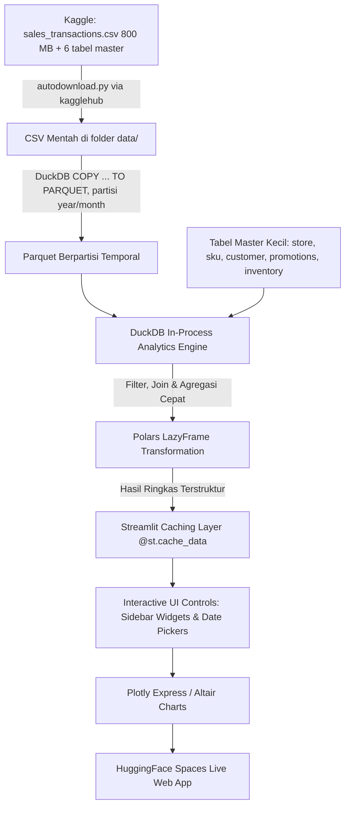

# Dokumen Arsitektur & Pitch Proposal Produk Data (Phase 1)

**Mata Kuliah:** Analisis Big Data  
**Target Check-in:** Pertemuan 10 (Diumumkan Pertemuan 8, repositori dibagikan Pertemuan 9)  
**Nama Tim:** Dika Dan Ahmad  
**Topik / Judul Produk Data:** Dashboard Analitik Ritel: Deteksi Stockout, Dead Stock, dan Efektivitas Promosi (10 Juta Transaksi)  

---

## 1. Problem Statement & Sasaran Pengguna (The Pitch)

### 1.1 Latar Belakang Masalah
Peritel multi-toko menghadapi dua masalah inventori yang berlawanan namun sama-sama merugikan:

- **Stockout:** produk terlaris habis di sebagian toko sehingga penjualan hilang. Penjualan yang hilang tidak tercatat di sistem kasir, sehingga kerugiannya sulit terlihat.
- **Dead stock:** produk yang jarang terjual ditimbun melebihi titik pemesanan ulang sehingga modal tertahan.

Selain itu, promosi dan diskon dijalankan tanpa selalu diketahui apakah benar menaikkan penjualan. Datanya ada dalam 10 juta baris transaksi selama 4 tahun (2022–2025) di 30 toko dan 5.000 SKU. Volume sebesar ini tidak bisa dibaca lewat spreadsheet, sehingga perlu disajikan secara interaktif agar manajer dapat memfilter per toko, kategori, kanal, dan periode, lalu langsung melihat polanya.

### 1.2 Target Pengguna (Target Audience)
- **Manajer inventori / supply chain:** memutuskan SKU dan toko mana yang perlu dipesan ulang atau di-clearance.
- **Category manager:** memantau performa kategori, merek, dan produk.
- **Tim pemasaran / promosi:** menilai efektivitas kampanye diskon.
- **Manajemen toko:** membandingkan performa antar toko dan kanal penjualan.

### 1.3 Nilai Tambah & Wawasan Utama
- SKU dan toko mana yang berisiko stockout, dan kapan jendela kehabisannya terjadi.
- SKU slow mover yang menahan modal, sehingga layak di-clearance.
- Promo, tipe diskon, dan kategori mana yang paling efektif menaikkan penjualan.
- Pola musiman (puncak November–Desember, penurunan Februari) dan pertumbuhan tahunan sebagai dasar perencanaan stok.
- Perbedaan perilaku antar kanal (In-Store, Online, Mobile App) dan segmen loyalitas pelanggan.

---

## 2. Sumber Dataset & Skala Data

| Parameter | Keterangan |
|-----------|------------|
| **Nama Dataset** | Synthetic Retail Dataset, 10 Million Transactions |
| **Sumber Resmi** | https://www.kaggle.com/datasets/mrayyanshehzad/synthetic-retail-dataset-10-million-transactions |
| **Format Awal** | CSV (dikonversi ke Parquet berpartisi untuk dashboard) |
| **Ukuran Data** | ± 800 MB dan 10.000.000 baris pada tabel `sales_transactions` (memenuhi syarat >500 MB dan >1 juta baris) |
| **Dimensi Waktu / Temporal** | 2022–2025, frekuensi harian |
| **Fitur / Kolom Kunci** | `date`, `receipt_id`, `store_id`, `sku_id`, `customer_id`, `quantity`, `total_value`, `channel`, `discount_pct`, `promo_id` (transaksi); `category`, `brand` (SKU); `city`, `store_type` (toko); `loyalty_segment` (pelanggan); `stock_on_hand`, `reorder_point` (inventori); `flag` (kunci jawaban anomali) |

**Versi data yang dipakai:** versi *contaminated* (berisi anomali inventori) sebagai data utama, karena menyediakan kunci jawaban `sku_inventory_flags.csv` untuk menguji deteksi stockout dan slow mover. Versi *clean* dapat dipakai sebagai pembanding.

**Tabel pendukung (kecil):** `store_master` (30 baris), `sku_master` (5.000), `customer_master` (10.000), `promotions` (100), `inventory_snapshot` (21.228), `sku_inventory_flags` (± 240).

---

## 3. Diagram Arsitektur Data & Aliran Informasi

Gambarkan alur bagaimana data mengalir dari disk mentah hingga ke antarmuka pengguna:

---

## 4. Rencana Pemrosesan Data & Strategi Caching

### 4.1 Peran DuckDB (SQL Engine)
- **Pembacaan data:** `sales_transactions.csv` dikonversi sekali ke Parquet berpartisi `year/month`, lalu dibaca langsung oleh DuckDB (`read_parquet` dengan filter partisi) tanpa memuat seluruh data ke memori. Tabel master kecil dibaca langsung dari CSV.
- **Operasi berat yang didelegasikan ke DuckDB:**
  - Agregasi penjualan harian, bulanan, per toko, per kategori, dan per kanal.
  - `JOIN` tabel transaksi dengan `sku_master`, `store_master`, `customer_master`, dan `promotions`.
  - Window function untuk running total dan penjualan harian per SKU.
  - Perbandingan penjualan dengan promo vs tanpa promo.
  - `SUMMARIZE` untuk profil awal data.

### 4.2 Peran Polars (Transformasi Data)
- Moving average 7 dan 30 hari serta fitur lag untuk tren penjualan.
- Deteksi gap penjualan (hari tanpa penjualan pada toko × SKU) sebagai indikasi stockout, lalu dibandingkan dengan `sku_inventory_flags.csv`.
- Perhitungan rasio `stock_on_hand` terhadap `reorder_point` untuk menandai slow mover dan risiko stockout.
- Analisis keranjang belanja (`receipt_id`) dan segmentasi pelanggan (RFM).
- Pivot untuk heatmap musiman (bulan × tahun) dan perbandingan antar toko.

### 4.3 Strategi Optimasi Memori & Caching Streamlit
- Semua kueri berat dibungkus fungsi dengan `@st.cache_data`, dengan parameter filter (rentang tanggal, toko, kategori, kanal) sebagai kunci cache, sehingga mengubah filter yang sama tidak menghitung ulang.
- Hanya hasil agregat yang masuk ke memori Streamlit. Dataset mentah 10 juta baris tidak disimpan di `st.session_state` maupun dimuat penuh ke pandas.
- Agregat yang sering dipakai (mis. penjualan harian per toko) dihitung di awal dan di-cache.
- Batas HuggingFace Spaces gratis adalah 16 GB RAM. Karena DuckDB membaca Parquet secara bertahap dan UI hanya menerima agregat, pemakaian memori tetap rendah.
- File data besar tidak di-commit ke GitHub (diabaikan lewat `.gitignore`), diunduh ulang atau disiapkan saat build.

---

## 5. Rencana Tampilan Dashboard (Wireframe & Fitur UI)

1. **Header & Key Metrics KPI:**
   - 4 Kartu metrik: total pendapatan, total transaksi, rata-rata nilai keranjang, dan persentase transaksi dengan promo (disertai tren persentase vs periode sebelumnya).
2. **Filter Interaktif (Sidebar):**
   - Pemilihan toko dan kota, slider rentang tanggal, filter kategori/merek, kanal penjualan, dan segmen loyalitas.
3. **Panel Visualisasi Utama:**
   - **Tab 1 — Tren Temporal:** Line chart pendapatan harian/bulanan dengan range slider dan moving average, serta heatmap musiman bulan × tahun.
   - **Tab 2 — Anomali Inventori:** Daftar dan grafik SKU berisiko stockout (jendela waktu dan toko terdampak) dan slow mover (stok jauh di atas titik pemesanan ulang). Hasil deteksi dibandingkan dengan kunci jawaban `sku_inventory_flags.csv`.
   - **Tab 3 — Promosi & Segmentasi:** Efektivitas diskon per tipe promo dan kategori, perbandingan kanal, dan segmen loyalitas.
   - **Tab 4 — Performa Wilayah:** Bar chart pendapatan per kota dan tipe toko. Data hanya memuat nama kota tanpa koordinat, sehingga peta dibuat dengan menambahkan koordinat kota secara manual (jika diperlukan).
   - **Tab 5 — Tabel Data Detail:** Cuplikan data terfilter dengan opsi unduh ringkasan CSV.

---

## 6. Pembagian Tugas & Tanggung Jawab Anggota Tim

| Anggota Tim | Tanggung Jawab Utama di Phase 1 - 4 |
|-------------|-------------------------------------|
| Wahyu Andika | Desain arsitektur, pipeline data (unduh, konversi CSV ke Parquet berpartisi), kueri analitik DuckDB, dan integrasi Dockerfile |
| Ahmad Nur Mu'minin | Transformasi Polars (moving average, deteksi anomali stok), desain antarmuka Streamlit, visualisasi Plotly, strategi caching, dan deployment ke HF Spaces |
